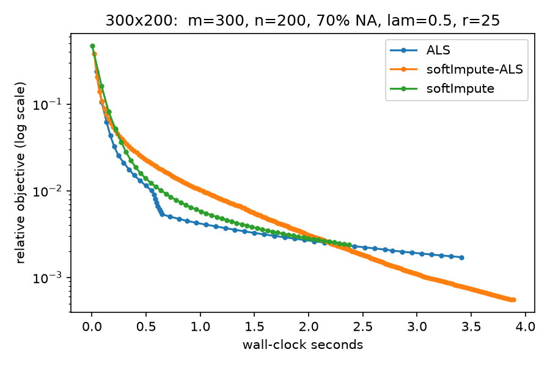
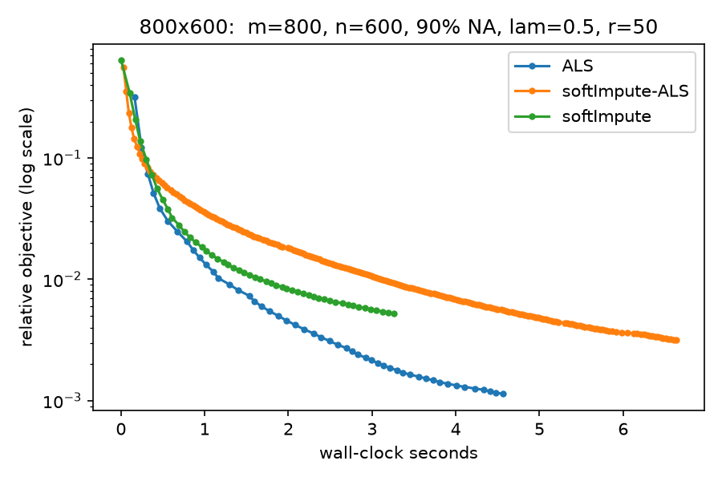
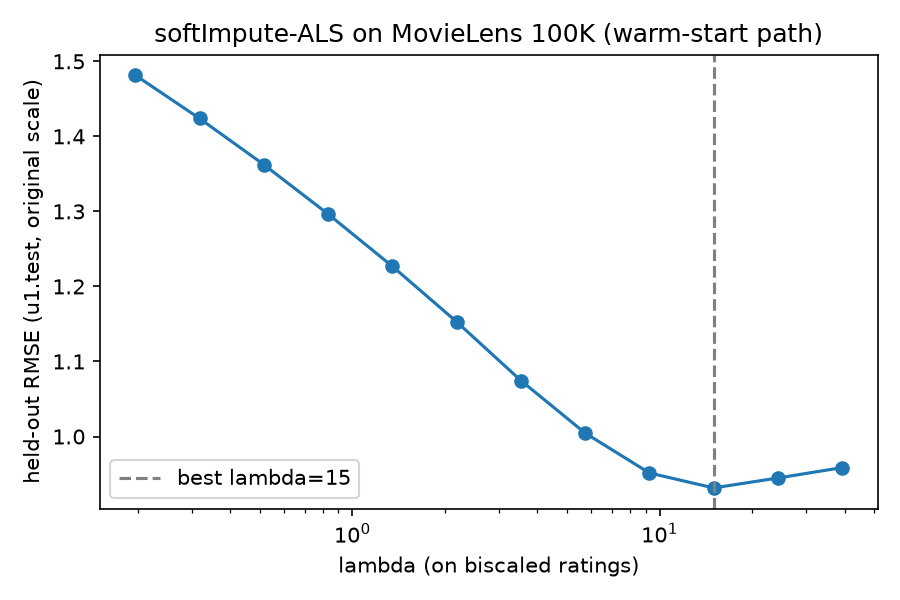

# softimpute-als

A Python implementation of the paper:

> Trevor Hastie, Rahul Mazumder, Jason D. Lee and Reza Zadeh (2015).
> **"Matrix Completion and Low-Rank SVD via Fast Alternating Least Squares."**
> *Journal of Machine Learning Research* 16, 3367–3402.

The paper unifies two classic approaches to the matrix-completion problem —
nuclear-norm-regularized matrix approximation (softImpute, Mazumder et al. 2010)
and maximum-margin matrix factorization (MMMF, Rennie & Srebro 2005) — and derives
**softImpute-ALS**, a fast alternating least squares algorithm that outperforms
both. This repository implements all three algorithms, the underlying theory
(Theorems 1–2, Algorithm 2.1), the warm-start solution path over the
regularization parameter, the centering/scaling preprocessing of Section 9, and
reproduces the paper's experiments, including an application to MovieLens 100K.

## The problem

Given an `m x n` matrix `X` observed only on an index set `Omega`, solve the
nuclear-norm-regularized completion problem

```
minimize_M   1/2 ||P(X - M)||_F^2  +  lambda ||M||_*          (paper, Eq. 1)
```

where `P` keeps observed entries and zeroes the rest, and `||M||_*` (nuclear
norm) is a convex relaxation of rank. Its rank-restricted factorization form is

```
minimize_{A,B}   1/2 ||P(X - A B^T)||_F^2  +  lambda/2 (||A||_F^2 + ||B||_F^2)
```

which is bi-convex and can be attacked by alternating least squares.

## The three algorithms

| Algorithm | Idea | Cost per iteration |
|---|---|---|
| **softImpute** (Mazumder et al. 2010) | fill in the missing entries with the current estimate, then compute a soft-thresholded SVD of the filled matrix | one rank-`r` SVD (the bottleneck) |
| **ALS** (Rennie & Srebro 2005; paper Alg. 5.2) | exact block coordinate descent: `m + n` separate ridge regressions, one per row/column | `O(|Omega| r^2)` |
| **softImpute-ALS** (paper Alg. 3.1 / 5.1) | each half-step is a *single multiresponse ridge regression* on the filled matrix `X~ = P(X - AB^T) + AB^T`, kept in sparse-plus-low-rank form | `O(|Omega| r + (m+n) r^2)` — about `r` times cheaper than ALS |

Key identities implemented here (paper Eqs. 24–25):

```
X~ = P(X) + P_perp(AB^T) = P(X - AB^T) + AB^T
```

the sparse piece being the residual at the observed entries, plus a final
soft-thresholded SVD cleanup (Alg. 3.1, step 5) that reveals the exact rank of
the solution. Iterates are kept in SVD form `M = U D^2 V^T`; the rotation of the
half-step SVD is carried between steps so the representation stays exact.

## Repository layout

```
├── src/softimpute_als/
│   ├── data.py           # incomplete-matrix container (triplets, masks, splits)
│   ├── low_rank.py       # SoftSVD container, soft-thresholding, warm-start padding
│   ├── operators.py      # sparse + low-rank FilledMatrix, final cleanup step
│   ├── soft_svd.py       # Algorithm 2.1 (complete matrix) + Theorems 1-2 references
│   ├── soft_impute.py    # softImpute baseline (Lanczos SVD via LinearOperator)
│   ├── als.py            # vanilla ALS (Algorithm 5.2)
│   ├── softimpute_als.py # softImpute-ALS (Algorithms 5.1 / 3.1) -- the paper's method
│   ├── scaling.py        # Section 9: biscale row/column centering and scaling
│   └── path.py           # lambda_max, warm-start lambda path, hold-out CV
├── tests/                # 19 tests validating the theorems and the algorithms
├── experiments/
│   ├── exp_timing.py     # Section 6.1-style timing comparison
│   └── exp_movielens.py  # MovieLens 100K application
└── results/              # generated plots and summary numbers
```

## Installation

```bash
pip install -e ".[dev]"      # numpy + scipy (matplotlib/pandas for experiments)
pytest                       # 19 tests
```

## Quick start

```python
import numpy as np
from softimpute_als import IncompleteMatrix, biscale, cv_lambda

# ratings matrix observed on some entries (rows=users, cols=items)
rng = np.random.default_rng(0)
rows, cols = rng.integers(0, 100, 200), rng.integers(0, 80, 200)
vals = rng.standard_normal(200).round(1)
X = IncompleteMatrix(rows, cols, vals, shape=(100, 80))

Xs = biscale(X).transform(X)               # Section 9: center/scale rows+cols
res = cv_lambda(Xs, n_lambda=8, rank_max=20)  # warm-start path + hold-out CV

pred = res["fit"].predict(rows, cols)       # completed entries
print("best lambda:", res["best_lambda"])
```

Individual algorithms:

```python
from softimpute_als import soft_impute_als, soft_impute, als

fit, info = soft_impute_als(X, lam=2.0, rank=10)   # returns a SoftSVD object
fit.rank                                            # exact rank of the solution
fit.predict(rows, cols)                             # impute arbitrary entries
```

## Results

### Timing (reproduces Section 6.1)

Relative objective `(F_k - F*)/F*` against wall-clock time, on the paper's two
simulation settings (rank-15 signal in a 300x200 matrix with 70% missing
entries, r=25; rank-31 signal in an 800x600 matrix with 90% missing, r=50).

| Setting | ALS s/iter | softImpute-ALS s/iter | softImpute s/iter |
|---|---|---|---|
| 300 x 200, 70% NA, r=25 | 0.088 | **0.020** | 0.047 |
| 800 x 600, 90% NA, r=50 | 0.087 | **0.032** | 0.066 |




softImpute-ALS is the cheapest iteration, as predicted by the complexity
analysis; per unit of time the three methods are comparable on these
small problems, in line with the paper's discussion.

### MovieLens 100K (u1.base / u1.test split)

The ratings matrix (943 users x 1682 items, 80K/20K train/test ratings) is
row/column centered and scaled with the method of moments of Section 9, then
softImpute-ALS is fit along a warm-start lambda path. The path exhibits the
behaviour described in the paper: the rank of the solution grows as lambda
decreases, and warm starts are used along the path.

| Method | held-out RMSE |
|---|---|
| global mean baseline | 1.154 |
| ALS | 0.932 |
| **softImpute-ALS** | **0.932** |
| softImpute | 0.932 |

All three methods converge to (essentially) the same solution — the practical
face of the paper's equivalence result — with softImpute-ALS the fastest
(15.7s vs 23.9s / 30.2s for this run).



## What the tests validate

- `test_soft_svd.py` — Algorithm 2.1 reproduces the closed-form soft-thresholded
  SVD of Theorem 1 on complete matrices; the balanced factorization of
  Theorem 2 is a local optimum of problem (14); the criterion is non-increasing.
- `test_algorithms.py` — on complete data all three algorithms recover the
  same soft-thresholded SVD; on incomplete data softImpute and softImpute-ALS
  converge to the same fixed point (the nuclear-norm/MMMF equivalence);
  softImpute-ALS is a descent method (majorize-minimize); the solution is
  exactly rank 0 for `lambda >= lambda_max`; warm starts along the path reduce
  iterations.
- `test_path.py` — lambda path properties, cross-validation, and the biscale
  centering/scaling conditions of Section 9.

## Notes and deviations

- `soft_svd_als` carries the rotation `R` of the half-step SVD
  (`B~D = V~ D~^2 R^T`) onto `U` (i.e. `U <- U R`). As printed in the paper,
  Algorithm 2.1 drops `R`, which makes the intermediate SVD-form representation
  inexact (in practice, sign flips); carrying it makes the SVD-form iterates the
  exact majorize-minimize steps of Algorithm 5.1, with a non-increasing criterion.
- `svds` (PROPACK-like Lanczos) is used for the reduced-rank SVD inside
  softImpute, applied through `LinearOperator`s to the sparse-plus-low-rank
  filled matrix, which is never materialized.
- Vanilla ALS adds a tiny ridge `jitter=1e-10` to keep the per-row normal
  equations invertible when a row/column observes fewer than `rank` entries.

## References

- Hastie, T., Mazumder, R., Lee, J. D., & Zadeh, R. (2015). Matrix Completion
  and Low-Rank SVD via Fast Alternating Least Squares. *JMLR* 16, 3367–3402.
- Mazumder, R., Hastie, T., & Tibshirani, R. (2010). Spectral Regularization
  Algorithms for Learning Large Incomplete Matrices. *JMLR* 11, 2287–2322.
- Rennie, J. D. M., & Srebro, N. (2005). Fast Maximum Margin Matrix Factorization
  for Collaborative Prediction. *ICML 2005*.
- MovieLens 100K: F. Maxwell Harper and Joseph A. Konstan. 2015. The MovieLens
  Datasets: History and Context. *ACM TiiS* 5, 4.

## License

MIT
